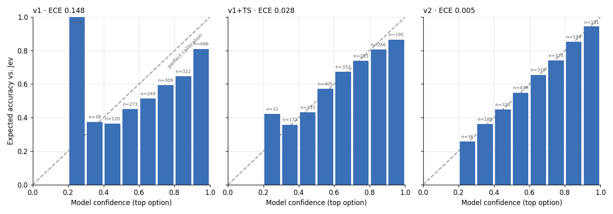
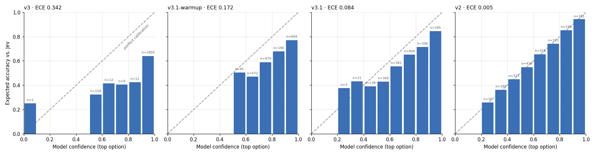

# Mini-Jev: Teaching a 1.7B model to be honest about its confidence

Can a small open model copy a proprietary decision model **and** know how sure to be? This project distills [TypeSafe's Jev](https://typesafe.ai) into Qwen3-1.7B and compares three ways of getting calibrated confidence: supervised fine-tuning, distillation on soft labels, and reinforcement learning from outcomes only. Everything runs on a free Colab T4.



*Reliability diagrams: bars on the dashed line mean stated confidence matches how often the model is right. v2 (right) is near-perfect.*

## TL;DR

| | Agreement with Jev | ECE ↓ | Takeaway |
|---|---|---|---|
| v0: untrained | 0.349 | 0.590 | Answers "B" regardless of content; worse than a no-model baseline |
| v1: SFT on Jev's top answer | **0.788** | 0.148 | Learns the task, but 15 points overconfident |
| v1 + temperature scaling | 0.788 | 0.028 | One post-hoc number fixes most of it |
| **v2: distillation on Jev's probabilities** | 0.774 | **0.005** | Near-perfect calibration, no post-hoc fix needed |
| v3: GRPO, default normalization | 0.755 | 0.342 | RL made confidence *worse* |
| v3.1: GRPO, fixed normalization | 0.753 | 0.084 | RL halves calibration error from outcomes alone |
| v2 deployed: fixed merge → GGUF Q8_0 (1.83 GB) | 0.777 | 0.008 | Half the size, calibration intact |

**Main findings**
1. **Hard labels teach false certainty.** SFT on Jev's top answer reached 79% agreement but stayed 15 points overconfident.
2. **Soft labels teach the teacher's doubt.** Distillation reached ECE 0.005 and beat temperature scaling on ECE, KL and Brier (paired bootstrap, 95% CIs exclude 0). Temperature scaling still recovered ~80% of the gain, so the cheap fix is a strong baseline.
3. **A correct RL reward can still be broken by the optimizer.** With a proper-scoring-rule reward, GRPO's default per-group standard-deviation normalization pushed stated confidence from 0.87 to 0.95. Replacing it with a mean-only baseline and one batch-wide scale reversed the direction (0.78 → 0.69) and cut ECE from 0.172 to 0.084 with no change in agreement.
4. **The standard deployment recipe silently broke calibration.** Merging the QLoRA adapter into the original 16-bit base raised ECE from 0.005 to 0.080. Merging into the *dequantized 4-bit* base instead reproduced the trained model exactly, and an 8-bit GGUF of it kept calibration at half the size. 4-bit GGUF cost 9 points of agreement.

## The question

[Jev](https://typesafe.ai) answers typed decision questions (yes/no, pick-one, 0–5 score) with probabilities instead of text. TypeSafe says it trains Jev with "Reinforcement Learning for Calibrated Decisions" (RLCD) but hasn't published the method. This project asks a smaller question: **how do different training signals affect a student model's calibration?**

- **v1, SFT:** learns only Jev's top answer
- **v2, distillation:** learns Jev's full probability distribution
- **v3/v3.1, RL from outcomes:** never sees Jev's probabilities; only a single outcome sampled from them, the way real-world feedback arrives. The model must *write* its confidence ("D 70"), and it's scored rather than shown an answer. This is my RLCD-style interpretation, not TypeSafe's actual method.

## Setup

- **Student:** [Qwen3-1.7B](https://huggingface.co/Qwen/Qwen3-1.7B), QLoRA (4-bit NF4 base, LoRA r=16 on all attention and MLP projections)
- **Data:** [SargeDev/jev-distill-corpus-v3](https://huggingface.co/datasets/SargeDev/jev-distill-corpus-v3). Labels are Jev's probability distributions over 2–16 options.
  - Removed rows with uniform (50/50) or tied-top labels, which carry no learning signal
  - Stratified sample by question type and domain: 19,393 training rows, 500 validation rows, and a fixed exam of 1,998 rows from the held-out `test_set_30k`, checked for leakage
- **Answer readout:** options are shown as letters, and the model's probability for each option is read from the next-token logits for those letters (one forward pass per question)
- **Hardware:** free Google Colab T4. SFT and distillation take ~1h45m each; RL takes ~2–3h

## Metrics

All metrics compare the student to **Jev**, not to real-world truth. The scenarios are synthetic, so Jev's labels are the only ground truth available.

- **Agreement:** the student's top answer matches Jev's top answer
- **ECE:** expected calibration error; do stated confidences match how often the answers are right (weighted by Jev's probabilities)? 0 is perfect
- **KL, Brier:** distance between the student's full distribution and Jev's
- **conf_mse:** for v3, squared error between the *stated* confidence and Jev's probability for that answer
- **Baselines:** a "prior" that always predicts Jev's average distribution per question type (agreement 0.399, ECE 0.028), which shows why ECE alone can never be the headline metric
- **Significance:** paired bootstrap (2,000 resamples) over exam rows

## Results

### Full table

| Version | Agreement | Mean conf. | Expected acc. | ECE | KL | Brier |
|---|---|---|---|---|---|---|
| v0 (zero-shot) | 0.349 | 0.930 | 0.341 | 0.590 | 5.025 | 0.821 |
| prior (no model) | 0.399 | 0.415 | 0.387 | 0.028 | 0.493 | 0.255 |
| v1 (SFT) | 0.788 | 0.776 | 0.629 | 0.148 | 0.319 | 0.126 |
| v1 + TS (T=1.9) | 0.788 | 0.637 | 0.629 | 0.028 | 0.177 | 0.088 |
| v2 (distillation) | 0.774 | 0.625 | 0.624 | **0.005** | **0.144** | **0.077** |
| v3 warm-up | 0.759 | 0.867 | 0.614 | 0.253 | | |
| v3 (default GRPO) | 0.755 | 0.953 | 0.612 | 0.342 | | |
| v3.1 warm-up | 0.755 | 0.783 | 0.611 | 0.172 | | |
| v3.1 (fixed GRPO) | 0.753 | 0.694 | 0.611 | 0.084 | | |

KL and Brier need a full distribution, so they don't apply to v3, which writes a single confidence. ECE is computed identically for every row.

### 1. The untrained model has position bias
Zero-shot, Qwen3-1.7B picked "B" on 94% of yes/no and 91% of score questions, and only 73% of its probability landed on valid answer letters. Always guessing the most common answer (40%) beat it.

### 2. SFT learns the task but not the doubt
Training on Jev's top answer raised agreement to 79% and fixed the position bias, but average confidence (0.78) exceeded what the answers were worth (0.63). Hard labels tell the model every answer was 100% certain.

### 3. Distillation fixes calibration, and beats the cheap fix
Training on Jev's full distribution gave ECE 0.005, with a fitted temperature of exactly 1.0 (nothing left to correct). Against v1 + temperature scaling:

| v2 − (v1+TS) | Diff | 95% CI |
|---|---|---|
| ECE | −0.023 | [−0.029, −0.010] |
| KL | −0.033 | [−0.039, −0.027] |
| Brier | −0.012 | [−0.015, −0.009] |
| Agreement | −0.014 | [−0.028, 0.001] (not significant) |

Temperature scaling is one global dial; distillation learns *per-question* uncertainty. The largest gains came on 0–5 score questions, where Jev is least certain (ECE 0.195 → 0.012).

### 4. RL from outcomes: reward design and an optimizer bug

**Reward design.** The Brier score alone, −(c − o)², can be gamed: on a question where Jev says A 45% / B 40% / C 15%, answering C at 15% scores better than answering A at 45%. It rewards being *sure*, not being *right*. The reward used is **o − (c − o)²** (correctness + Brier), whose optimum is "pick the most likely answer and state its true probability" (verified on 200 random distributions).

**The bug.** Standard GRPO divides each group's advantages by that group's standard deviation. With one outcome shared across the group, this erases the Brier score's asymmetry: when right, extra confidence gains little; when wrong, it costs a lot. After normalization both cases push equally hard, so any model that is right more than half the time is pushed toward 100% confidence. A toy simulation reproduces it:

| True probability | Per-group std (GRPO default) | One batch-wide scale (fix) |
|---|---|---|
| 0.45 | → 0.02 | → 0.40 |
| 0.61 | → 0.98 | → 0.61 |
| 0.75 | → 0.99 | → 0.80 |

This is consistent with the Dr. GRPO critique of std normalization (Liu et al., 2025).

**Results** (v3.1 also warms up on rows v1 never trained on; v3 used training rows, which inflated its starting confidence):

| Comparison | ECE diff | 95% CI | Agreement diff |
|---|---|---|---|
| v3.1 vs. its warm-up (effect of fixed RL) | −0.087 | [−0.094, −0.080] | −0.002 (n.s.) |
| v3.1 vs. v3 (fixed vs. default GRPO) | −0.257 | [−0.267, −0.247] | −0.002 (n.s.) |
| v3.1 vs. v2 | +0.080 | [+0.064, +0.086] | −0.022 [−0.037, −0.006] |

Fixed RL closed about half of the overconfidence gap from coin-flip outcomes alone, in 250 steps. Distillation, which sees full probabilities, remains clearly better.



### 5. Deployment: merging and quantization

A LoRA adapter is normally deployed by merging it into the base weights, then quantizing the result. Both steps were tested on v2.

**The merge mismatch.** v2's adapter was trained on a 4-bit NF4 base, so it learned to correct *those* weights, rounding errors included. Merging it into the original 16-bit weights applies the corrections to slightly different numbers.

| v2 version | Agreement | ECE | Same top answer as trained model |
|---|---|---|---|
| As trained (4-bit base + adapter) | 0.774 | 0.005 | 1.000 |
| Naive merge into 16-bit base | 0.744 | 0.080 | 0.870 |
| **Fixed: merge into dequantized 4-bit base** | 0.773 | **0.003** | **0.998** |

The naive merge is significantly worse on every metric; the fixed merge is statistically indistinguishable from the trained model on all of them.

**Quantizing the fixed model** (quality measured by loading each GGUF's weights through transformers):

| Format | Size | Agreement | ECE | vs. trained model |
|---|---|---|---|---|
| 16-bit | 3.44 GB | 0.773 | 0.003 | no significant difference |
| **GGUF Q8_0** | **1.83 GB** | 0.777 | 0.008 | no significant difference |
| GGUF Q4_K_M | 1.11 GB | 0.688 | 0.071 | −8.7 pts agreement, worse calibration |

8-bit preserves the model; 4-bit re-quantization rounds away most of the adapter's small corrections. A 4-bit deployment would need quantization-aware training or recalibration after quantizing.

**Speed** (merged 16-bit model family; one decision = one forward pass over a ~116-token prompt):
- **T4 GPU:** 16-bit took 60 ms per single decision, bitsandbytes NF4 98 ms, bitsandbytes 8-bit 223 ms. Smaller weights must be converted back for every multiply, so smaller was slower. Throughput peaked at ~31 decisions/s at batch 8, with no gain at batch 32.
- **CPU, llama.cpp, 2 threads:** token generation scaled with size (Q4_K_M 8.3 tok/s, Q8_0 5.6, F16 3.4), since it's memory-bound. Prompt reading didn't (Q8_0 was slowest at 18 tok/s, likely missing fast 8-bit kernels on this CPU). About 3.7 s per decision on CPU vs. ~30 ms batched on the GPU.

## Limitations

- **Teacher, not truth.** "Agreement" means agreeing with Jev. The error analysis found cases where Jev itself is questionable (e.g., rating a clinical pipeline with swapped sample indices as fairly high quality); a perfect student copies those errors.
- **Synthetic, templated data.** Scenarios include filler like "during peak load" in theology questions, which limits how far results generalize.
- **One training seed per model.** The bootstrap captures exam-sampling noise, not training-run variance.
- **Short RL run.** 250 GRPO steps on 2,000 questions. Whether longer runs close more of the gap to distillation is untested.
- **No KL penalty in RL** (β = 0, as in DAPO and Dr. GRPO), and one update per batch, so PPO-style clipping never activates.
- **Format cost.** The v3 reply format ("D 70") cost ~3 points of agreement vs. v1, introduced at warm-up, not by RL.
- **Specialization.** Fine-tuning for single-letter answers likely degrades general chat ability.
- **Quantization measurement.** GGUF quality was measured by expanding each file's weights to 16-bit in transformers, which captures rounding error but not llama.cpp's own kernels. One run (bitsandbytes NF4 applied to the fixed merge) produced implausible results (agreement 0.31, below the no-model baseline) and is excluded as a likely loading artifact.
- **Terms of use.** Labels are Jev outputs; check TypeSafe's terms before reusing any trained weights.

## Repository

| Notebook | What it does |
|---|---|
| [Phase 0–1: data and baseline](notebooks/mini_jev_phase0_1.ipynb) | Cleans the data, builds the splits, tests the untrained model (v0) |
| [v1: SFT](notebooks/mini_jev_v1_sft.ipynb) | Prior baseline, QLoRA SFT on Jev's top answers |
| [v2: distillation](notebooks/mini_jev_v2_distill.ipynb) | Soft-label distillation, temperature scaling, bootstrap comparison |
| [v3: GRPO (default)](notebooks/mini_jev_v3_grpo.ipynb) | Reward design, format warm-up, GRPO with default normalization |
| [v3.1: GRPO (fixed)](notebooks/mini_jev_v3_1_grpo_fixed.ipynb) | The normalization fix, with a simulation of the bug |
| [Inference](notebooks/mini_jev_inference.ipynb) | Merging, bitsandbytes and GGUF quantization, GPU/CPU speed, the merge fix |

```
results/
  results.csv                     every training version, all metrics
  inference_quality_with_fix.csv  quantization and merge results
  inference_speed_gpu.csv         T4 latency and throughput
  inference_speed_cpu.csv         llama.cpp prompt and generation speed
figures/
  reliability_v0.png, reliability_v0_v1.png, reliability_v1_v2.png,
  reliability_v3.png, reliability_v3_1.png, rl_curves_v3.png,
  rl_curves_v3_1.png, loss_v1.png,
  quant_size_vs_ece_naive_merge.png  (models from the naive merge, before the fix)
```

**To reproduce:** open the notebooks in order on a Colab T4. Each saves to `MyDrive/mini-jev/`, and every training notebook resumes from its last checkpoint after a disconnect.

## References

- Hinton, Vinyals, Dean (2015). *Distilling the Knowledge in a Neural Network.*
- Guo, Pleiss, Sun, Weinberger (2017). *On Calibration of Modern Neural Networks.*
- Shao et al. (2024). *DeepSeekMath* (introduces GRPO).
- Liu et al. (2025). *Understanding R1-Zero-Like Training: A Critical Perspective* (Dr. GRPO).
- Dettmers et al. (2023). *QLoRA: Efficient Finetuning of Quantized LLMs.*
